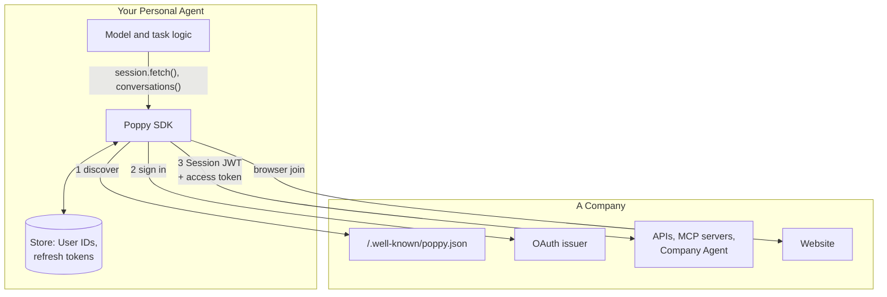

# Personal Agent Protocol TypeScript SDK

<!-- prettier-ignore -->
> [!IMPORTANT]
> **This SDK implements [0.4](https://personalagentprotocol.org/docs/0.4/spec) and [0.3](https://personalagentprotocol.org/docs/0.3/spec) of the Personal Agent Protocol.** Both are published and frozen, and a Company serves one of them while an agent meets many: `discover()` picks the newest version a Company serves that this SDK implements, and everything after that follows it. 0.4 is the 1.0 release candidate; draft 1.0 is still in progress, and can change in ways that aren't backward compatible, so each release names the versions it follows.

<!-- prettier-ignore -->
> [!NOTE]
> **This is a community SDK, not owned by any vendor.** It works with any Company and any authorization server that follows the spec. For a feature or a larger change, please [open an issue](https://github.com/descope/poppy-js/issues/new) first; see [CONTRIBUTING.md](CONTRIBUTING.md).

  

<details>
<summary>Table of Contents</summary>

- [Overview](#overview)
- [How it works](#how-it-works)
- [Installation](#installation)
- [Getting Started](#getting-started)
- [What's included](#whats-included)
- [Documentation](#documentation)
- [Contributing](#contributing)
- [License](#license)

</details>

## Overview

The Personal Agent Protocol (Poppy for short) lets a Personal Agent, acting for one User, work with a Company on that User's behalf. The Company publishes `/.well-known/poppy.json`, and the Personal Agent uses it to find the Company's APIs, website and Company Agent, identify itself and the User on every request, and get the User's approval for account access through standard OAuth.

This repository contains the TypeScript SDK for the **Personal Agent** side of the protocol. It handles the protocol for you, so your agent can focus on the User's task:

- **Discovery** of a Company, with every check the spec requires before anything is sent to it, including picking the newest protocol version it serves that this SDK implements
- **Sessions**: a pairwise User ID per Company, and a fresh, signed Session JWT on every request
- **Sign-in** with Direct, Device or Mediated Sign-In, and automatic token refresh, rotation and DPoP
- **Interactions**: APIs and MCP servers, the Company's website through browser join, and conversations with the Company Agent
- **Task coverage**: a Company's excluded tasks, skills and feedback endpoint, from `poppy.json` on 0.3 or per Session on 0.4, behind one API
- The **Operations**, **Links** and **Disclosures** extensions
- **UCP**: through Poppy's UCP extension, discover a Company's Universal Commerce Protocol profile, negotiate, and check out with signed requests in the User's Poppy Session
- **A conformance suite** that checks a Personal Agent in any language against the spec, which this SDK passes in full
- **Tools for models**: hand a Company to the Vercel AI SDK, Anthropic, OpenAI or any MCP client as tools, with secrets kept out of the model

It has zero runtime dependencies, uses `fetch` and WebCrypto only, and runs on Node.js 22 or later.

## How it works

Your agent talks to the SDK. The SDK talks to the Company, and keeps every secret (keys, tokens, Session JWTs, codes) out of your model's context.



Signed out, a request carries only the Session header, which says which Personal Agent, User and Session it belongs to. Once the User signs in, the same request also carries an OAuth access token for their account. [How it works](docs/how-it-works.md) walks through each flow with sequence diagrams.

## Installation

```bash
npm install @descope/poppy
# or
pnpm add @descope/poppy
# or
yarn add @descope/poppy
```

The package isn't published to npm yet. Until it is, install it from this repository.

## Getting Started

Here is what a Personal Agent looks like. It finds a Company, asks its Company Agent a question while signed out, and calls an API, signing the User in when the API asks for their account:

```typescript
import { PoppyAgent, scopesNeeded } from "@descope/poppy";

const agent = new PoppyAgent({
  clientId: "https://agent.example.net/agent.json",
  signingKey: { privateKey, kid: "agent-key-1" },
  redirectUri: "https://agent.example.net/oauth/callback",
});

const company = await agent.discover("example.com");
const user = await agent.user(company, "your-own-user-id");
const session = user.session();

// Talk to the Company Agent, signed out.
const { conversation } = await session.conversations().start({
  text: "Do you have the Stormline jacket in medium?",
  context: { locale: "en-US", user_available: true },
});
const { events } = await conversation.readAll({ wait: 10 });

// Call an API. If it needs the User's account, sign them in and try again.
let response = await session.fetch("https://api.example.com/orders");
const scope = scopesNeeded(response);
if (scope !== undefined) {
  const { url } = await user.startDirectSignIn({ scope });
  // Open `url` in the User's browser. When it returns to your redirect URI:
  await agent.completeDirectSignIn(company, callbackUrl);
  response = await session.fetch("https://api.example.com/orders");
}
```

Ready to build something real? Follow the step-by-step tutorial:

- [Build your first Personal Agent](docs/get-started/first-agent.md): from an agent identity to a signed-in API call and a conversation

Using an LLM framework? Hand the Company to your model as tools:

```typescript
import { generateText, jsonSchema, tool } from "ai";
import { poppyTools, toAiSdkTools } from "@descope/poppy";

const tools = toAiSdkTools(poppyTools({ user, requestApproval, signIn }), { tool, jsonSchema });
```

See [Tools for models](docs/tools.md) for the Anthropic, OpenAI and MCP versions.

For a runnable script, see [`examples/quickstart.ts`](examples/quickstart.ts).

## What's included

| Spec section     | What the SDK does                                                                                                                                                                                                                              |
| ---------------- | ---------------------------------------------------------------------------------------------------------------------------------------------------------------------------------------------------------------------------------------------- |
| 3 Discovery      | `agent.discover()` reads `poppy.json`, finds the issuer from the domain's protected resource metadata, and checks the link between the domain and the issuer in both directions. It also reads the logo, `auth.disabled` and the skill index.  |
| 4 OAuth          | `user.startDirectSignIn()`, `user.startDeviceSignIn()`, `user.mediatedSignIn()` and `user.signOut()`. Refresh, rotation, DPoP and per-service tokens happen inside `session.fetch()`.                                                          |
| 5 Sessions       | `agent.user()` keeps a random User ID per User per Company. `user.session()` starts a Session. Every request to a listed API or endpoint gets a Session JWT signed with a short-lived delegated key, and `session_ended` starts a new Session. |
| 6 Web browsing   | `session.joinBrowser()` joins your agent's own browser to the Session.                                                                                                                                                                         |
| 7 APIs           | `session.fetch()` for OpenAPI APIs, and as the `fetch` of any MCP client.                                                                                                                                                                      |
| 8 Conversations  | `session.conversations()` to start, send, read, stream, hand off, close and open Direct Conversations, including ones the Company asks for and speaks first in.                                                                                |
| 9 Task coverage  | `session.excludedTasks()`, `session.sendFeedback()`, and `session.fetchSkill()` for the Company's skills.                                                                                                                                      |
| Extensions       | Operations (`operationFromResponse()`, `approvalFor()`, `renderSummary()`), Links and Disclosures in messages, Mediated Sign-In, and UCP.                                                                                                      |
| Tools for models | `poppyTools()`, with `toAiSdkTools()`, `toAnthropicTools()`, `toOpenAITools()` and `toMcpTools()`.                                                                                                                                             |
| UCP              | `discoverCompanyUcp()`, `negotiateUcp()` and `UcpClient` for checkout, carts, catalog and orders, with signed requests in the User's Session.                                                                                                  |
| Conformance      | `@descope/poppy/conformance` checks any Personal Agent against the spec's rules for agents.                                                                                                                                                    |

## Documentation

- [Build your first Personal Agent](docs/get-started/first-agent.md): a step-by-step tutorial
- [Tools for models](docs/tools.md): give a model a Company's APIs and Company Agent as tools, with the AI SDK, Anthropic, OpenAI or MCP
- [UCP](docs/ucp.md): commerce with the Universal Commerce Protocol, next to Poppy
- [Conformance](packages/conformance/README.md): test any Personal Agent, in any language, against the spec's rules, with a CLI, baselines and a GitHub Action
- [How it works](docs/how-it-works.md): discovery, Sessions, sign-in, requests, browser join, conversations and operations, with sequence diagrams
- [Security and storage](docs/security.md): what the SDK protects, what it stores, and what you must protect
- [Troubleshooting](docs/troubleshooting.md): common errors and their fixes
- [Interoperability](docs/interop.md): how the SDK is tested against the spec project's conformance fake
- [Personal Agent Protocol specification](https://personalagentprotocol.org/docs/spec.md)

## Contributing

Issues and pull requests are welcome on GitHub at <https://github.com/descope/poppy-js>. See [CONTRIBUTING.md](CONTRIBUTING.md) for setup and guidelines, and [MAINTAINERS.md](MAINTAINERS.md) for who maintains the project. Questions about the protocol itself belong in the [specification's repository](https://github.com/personal-agent-protocol/personal-agent-protocol/issues).

This project follows a [Code of Conduct](CODE_OF_CONDUCT.md). Report vulnerabilities as [SECURITY.md](SECURITY.md) describes.

## License

This project is licensed under the Apache License 2.0. See the [LICENSE](LICENSE) file for details.
