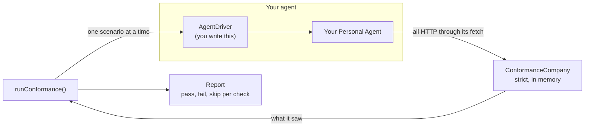

# Conformance

The spec project's validator tests Companies. This suite tests the other side: it checks a Personal Agent against the rules spec 0.4 and 0.3 set for Personal Agents, and reports each one as passed, failed or skipped. It's meant for any Personal Agent SDK or agent, not just this one, and this SDK passes every check.

There are two ways to run it:

- **Any language: the `@descope/poppy-conformance` CLI.** It runs your agent as a process once per scenario, through an HTTPS proxy. See [its README](../packages/conformance/README.md) for the agent contract, expected-failure baselines and the GitHub Action.
- **TypeScript, in one process: `runConformance()`.** The same scenarios and checks, called directly, with no proxy. The rest of this page covers it.



## What it checks

The 32 checks cover:

| Area                 | Checks                                                                                                                                                                                                                                                                                              |
| -------------------- | --------------------------------------------------------------------------------------------------------------------------------------------------------------------------------------------------------------------------------------------------------------------------------------------------- |
| Agent identity (4.1) | Client metadata, public-only key set                                                                                                                                                                                                                                                                |
| Discovery (3)        | Refusing uploaded or misdirected documents, wrong domains, unsupported versions, unlinked issuers, failed metadata, and private addresses                                                                                                                                                           |
| Sessions (5)         | The Session header everywhere it belongs and nowhere else, even on a listed host, the Session JWT's form and claims, `ath`, delegations and their privacy, one delegated key per User ID, stable IDs, no secrets in URLs, a new Session after `session_ended`, and no retry after `invalid_session` |
| OAuth (4)            | Client assertions, Direct Sign-In with PKCE, the `iss` check, extra scopes, refresh rotation, revocation, DPoP, and resource tokens for MCP                                                                                                                                                         |
| Requests (3)         | No credentials to a redirect's target                                                                                                                                                                                                                                                               |
| Conversations (8)    | Message IDs, authors and content                                                                                                                                                                                                                                                                    |
| Operations           | The approval header, on the same request                                                                                                                                                                                                                                                            |

`CHECKS` lists every check with its spec section and level.

## Run it

Write an `AgentFactory` that makes a fresh agent sending all of its HTTP through the `fetch` it's given, and wrap your agent's API in an `AgentDriver`. Only `discover` and `request` are required. Checks that need another method are skipped without it.

```typescript
import { formatReport, runConformance } from "@descope/poppy/conformance";

const report = await runConformance(async ({ fetch }) => {
  const agent = createMyAgent({ fetch });
  return {
    discover: (website) => agent.connect(website),
    request: async (url, init) => (await agent.call(url, init)).status,
    signInDirect: async (scope, browser) => {
      const url = await agent.beginSignIn(scope);
      await agent.finishSignIn(await browser(url));
    },
    signOut: () => agent.signOut(),
    converse: async (text) => {
      const conversation = await agent.chat(text);
      await conversation.reply("Thanks");
    },
    requestWithApproval: async (url, init) => agent.callApprovingOperations(url, init),
  };
});

console.log(formatReport(report));
process.exitCode = report.failed > 0 ? 1 : 0;
```

The conformance Company fetches your agent's client metadata and key set from its `client_id`, as a real Company would. To test before they're published, pass `agentFetch` to serve them yourself. [`test/conformance.test.ts`](../test/conformance.test.ts) runs this SDK through the suite this way.

The output looks like this:

```text
Personal Agent Protocol 0.4 and 0.3 conformance: 40 passed, 0 failed, 0 skipped
PASS  MUST   4.1           identity.metadata
PASS  MUST   3             discovery.well-known-path
...
```

## Limits

- The suite checks what an agent sends, so rules about what an agent shows the User, such as the Company's name with a Device Sign-In link, are out of its reach.
- Device Sign-In, Mediated Sign-In, browser join and streaming aren't covered yet.
