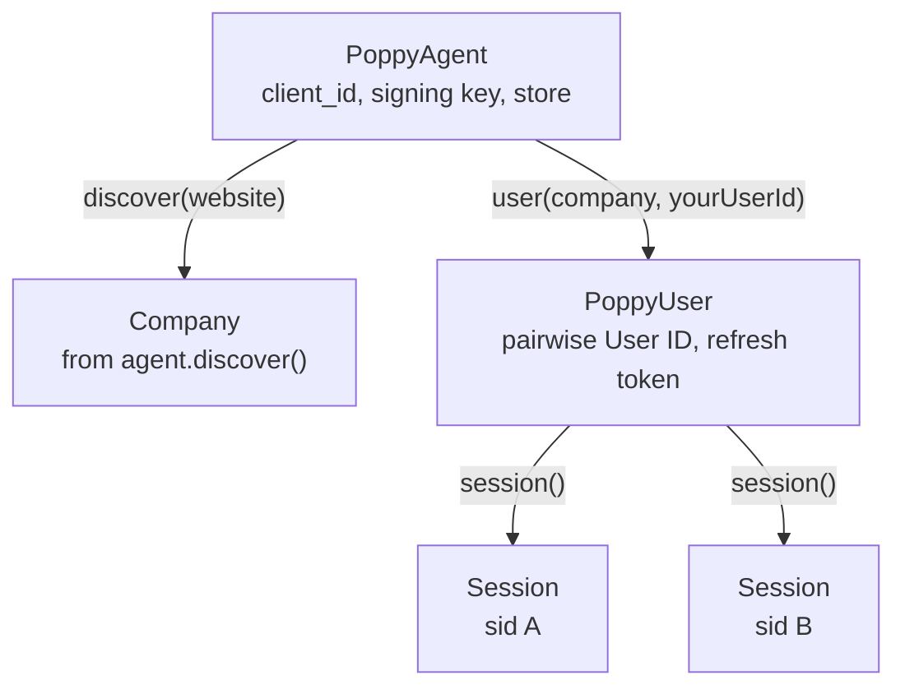
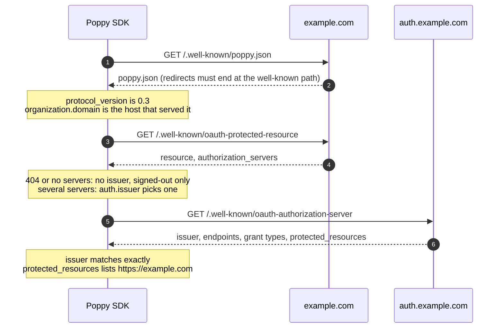
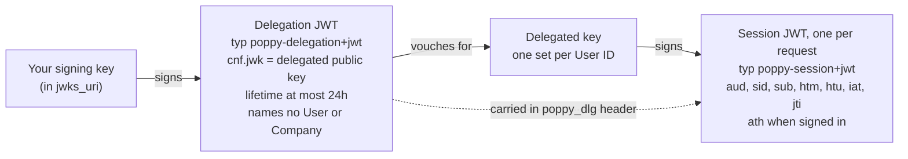
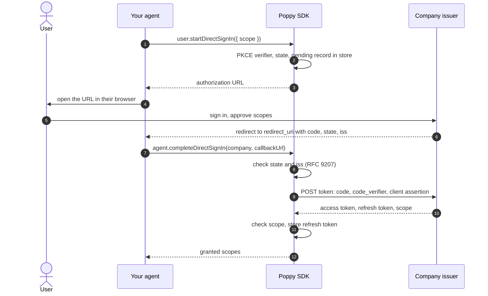
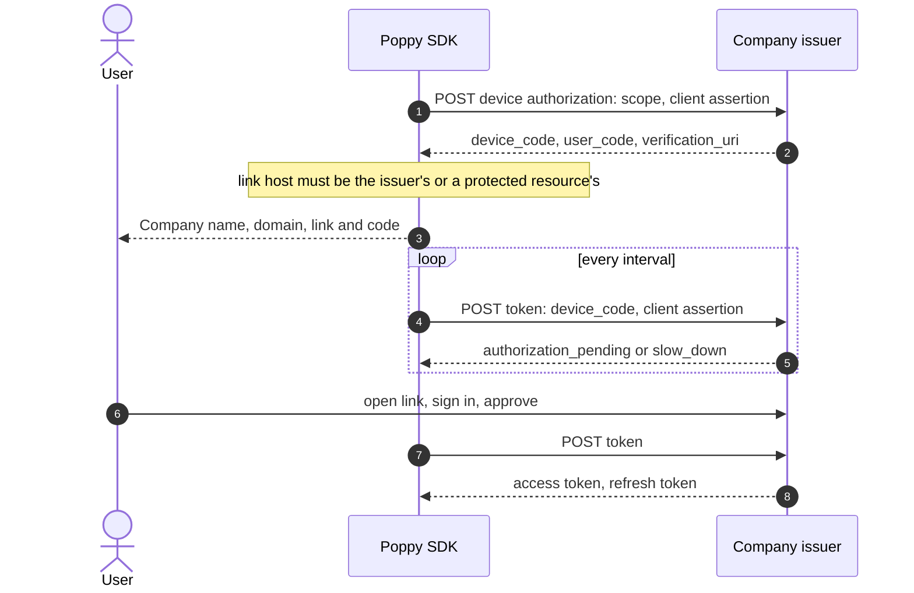
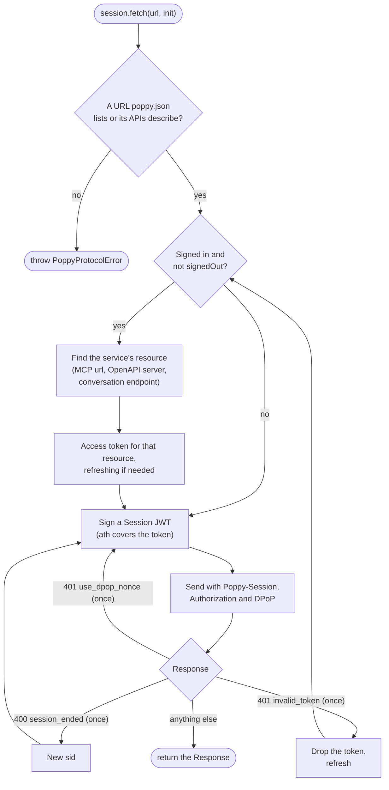
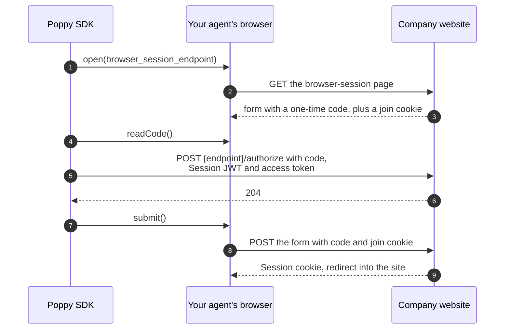
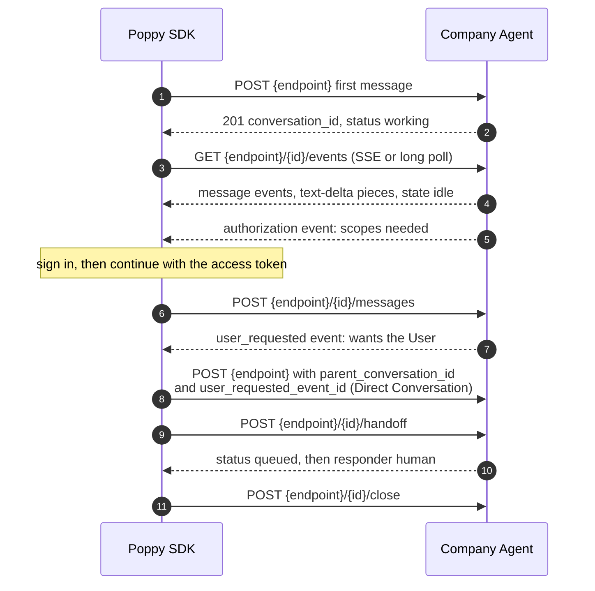
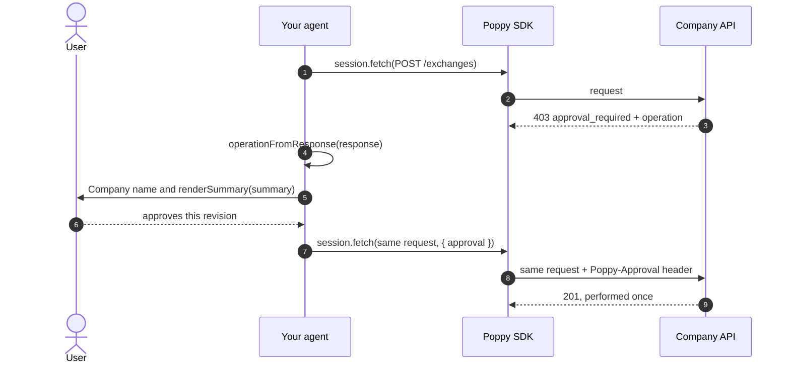

# How it works

This page follows a request from discovery to a signed-in API call, then covers the rest of the protocol: browser join, conversations and operations. Section numbers refer to [spec draft 0.3](https://personalagentprotocol.org/docs/spec.md).

- [The parties](#the-parties)
- [Discovery](#discovery)
- [Users, Sessions and the Session header](#users-sessions-and-the-session-header)
- [Signing in](#signing-in)
- [Sending a request](#sending-a-request)
- [Joining a browser](#joining-a-browser)
- [Conversations](#conversations)
- [Operations](#operations)

## The parties

A **User** is the person your agent acts for. Your **Personal Agent** is identified by its `client_id`, the HTTPS URL of a metadata document you publish, and it signs with keys from the `jwks_uri` that document names. A **Company** publishes `poppy.json`, and may run an OAuth issuer, APIs, MCP servers, a website and a **Company Agent**.

In the SDK, a `PoppyAgent` is your Personal Agent, a `PoppyUser` is one of your Users at one Company, and a `Session` is one stretch of that User's activity there.



A User can have several Sessions at once, for tasks running in parallel. They share the User's sign-in.

## Discovery

`agent.discover("example.com")` fetches the Company's documents and checks them before the SDK sends the Company anything (spec 3).



The domain names its issuer, and the issuer lists the domain back, so one domain can't claim another Company's issuer and receive its tokens. The result is a `Company` with:

- `identifier`: the issuer, or `https://{domain}` for a Company without one. Session JWTs are addressed to it, and User IDs are scoped by it.
- `name`, `domain` and `logoUri`, which you show the User together.
- `signIn`: which of Direct, Device and Mediated Sign-In the Company offers. All of them are off when the Company sets `auth.disabled`, and the SDK then refuses to start sign-in (spec 3.2).
- `apis`, `conversationProtocols`, `browserSessionEndpoint`, `feedbackEndpoint`, `excludedTasksUrl` and `extensions`.
- `scopes` and `scopeHints`, which describe what each scope allows.
- `skills`, from the Company's `skill_index` (spec 9.4). `session.fetchSkill(name)` fetches one with no credentials and checks its digest. A skill explains how to do a task through the Company's APIs, but it grants no access and no approval.
- `ucp`, when the Company lists the UCP extension. See [UCP](ucp.md).

## Users, Sessions and the Session header

`agent.user(company, "your-own-user-id")` returns the User's **User ID** at that Company. The SDK generates it at random the first time and keeps it in your store, so it's stable, different at every Company, and not derived from anything personal (spec 5.1). The Company never sees your own user ID.

Every request to the Company's APIs, conversations and other protocol endpoints carries a `Poppy-Session` header: a JWT signed fresh for that one request (spec 5.2). Your signing key doesn't sign it directly. Instead, it signs a short-lived **delegation** that vouches for a **delegated key**, and the delegated key signs the Session JWTs.



This keeps your signing key away from anything that names a User or a Company, and limits a leaked delegated key to one User at one Company until its delegation expires (spec 10.7). The SDK renews delegations before they expire and keeps delegated keys in memory only.

## Signing in

A Session starts signed out. When a task needs the User's account, the User signs in with OAuth, and the SDK stores the refresh token for the account (spec 4). Sign-in doesn't belong to one Session: every Session of the User uses it.

### Direct Sign-In

Direct Sign-In (spec 4.2) is the authorization code grant with PKCE. The User signs in on the Company's own page.



The pending record lives in your store, so the callback can be handled by another process that shares it. A new sign-in requests the scopes the User already granted plus the new ones, and revokes the refresh token it replaces.

### Device Sign-In

Device Sign-In (spec 4.3) suits agents that can't receive a browser redirect. The User signs in on any device with a link and a short code.



The device code never leaves the `DeviceSignIn` object. Prefer Direct Sign-In when you can, since a device code is easier to use for phishing.

### Mediated Sign-In

Mediated Sign-In is a transitional extension for Companies that offer neither of the above. The User gives your agent credentials for that Company, and `user.mediatedSignIn()` sends them only to the issuer's token endpoint. If the Company sends the User a one-time code, the result has `status: "code_required"` and a `submitCode()` function.

### Refresh, sign-out and accounts

- Access tokens stay in memory. The SDK refreshes them when they expire, uses a rotated refresh token from then on, and continues signed out if refresh returns `invalid_grant` (spec 4.4, 5.5).
- `user.signOut()` revokes the refresh token. Sessions carry on signed out.
- Separate accounts at one Company, such as personal and business, use `agent.user(company, id, { account: "business" })`, each with its own refresh token.

## Sending a request

`session.fetch()` is a `fetch` that speaks Poppy. It works out which token the request needs, signs the Session JWT, and handles the retries the spec defines.



- **Where the Session header goes.** Only to URLs the Company's `poppy.json` lists, or that its APIs describe: an OpenAPI description's server, an MCP server, the conversation endpoint and its routes, and the other endpoints it names (spec 5.2). Another path on the same host gets no Session header. When an OpenAPI description can't be loaded, requests to that API fail until it can.
- **Ended and invalid Sessions.** On `session_ended`, the SDK starts a new Session with a new `sid` and sends the request once more. The old Session's state, such as a cart, doesn't carry over, but conversations do (spec 5.5). `invalid_session` comes back to you without a retry, since a new Session doesn't fix it (spec 5.3).
- **Which token.** By default one access token works at all of a Company's services. A service whose protected resource metadata names its own `resource`, as every MCP server does, gets a token issued for it (spec 4.5, RFC 8707).
- **Bearer or DPoP.** If the issuer lists ES256 for DPoP, token requests carry a proof. The issuer decides whether to bind each token, and the SDK sends it as its `token_type` says, including at MCP servers (spec 4.5). An MCP server without protected resource metadata offers no account access, so it gets no token.
- **Redirects** are returned to you, never followed, so a token or Session JWT never reaches another URL (spec 3).
- **Other errors** come back as the `Response`. `scopesNeeded(response)` tells you which scopes to sign in for, and `authChallenge(response)` reads the full `WWW-Authenticate` challenge.

To use an MCP server, pass `session.fetch` to an MCP client:

```typescript
import { Client, StreamableHTTPClientTransport } from "@modelcontextprotocol/client";

const mcp = company.apis.find((api) => api.type === "mcp");
const transport = new StreamableHTTPClientTransport(new URL(mcp.url), {
  fetch: (url, init) => session.fetch(url, init),
});
const client = new Client({ name: "my-agent", version: "1.0.0" });
await client.connect(transport);
```

## Joining a browser

When your agent browses the Company's website, it joins its browser to the Session, so the website sees the same Session as the APIs (spec 6). The access token never passes through the browser.



`session.joinBrowser()` runs these steps with a `BrowserJoiner` you implement for your browser, such as Playwright. Join only your agent's own browser, never the User's. Join again after signing in or out, so the website matches.

## Conversations

`session.conversations()` talks with the Company Agent (spec 8). A conversation is a list of events: messages from both sides, state changes, and requests from the Company.



- `conversation.stream()` reads events as server-sent events, reconnecting with `Last-Event-ID`, and falls back to long polling for Companies that don't stream.
- Events are handled in order and never twice. Save `conversation.id`, `cursor` and `handledEventIds` to resume in another Session with `conversations.resume()`.
- To retry a message after a failure, send it again with the same `id`. The Company won't add it twice.
- `author.type` is `human` only for the User's own words, and is the default in Direct Conversations.
- To accept a `user_requested` event, you can call `conversation.openDirect(message, { userRequestedEventId })`. The message is optional. Without one, the Company speaks first (spec 8.10).
- Content that an extension defines travels in a message's `extensions` (spec 8.4). The SDK reads `message.operation` from the Operations extension, `message.links` from the Links extension, and `message.disclosures` from the Disclosures extension. Links and disclosures are Company content, so you decide whether and how to show them. Showing each link's domain helps the User see where it goes.

## Operations

With the Operations extension, a Company asks for the User's approval of exact terms before an action such as an exchange or a payment. Your agent lists `operations` version `2` in its client metadata and in `extensions` on the `PoppyAgent`.



- The Company performs only what the approved revision describes, and at most once. A retry with the same approval never performs it twice.
- `renderSummary()` renders only emphasis, paragraphs and lists, and shows links, images and HTML as text, so a summary can't send the User elsewhere.
- In MCP, read the operation with `operationFromToolResult()` and send `approvalMeta()` in the tool call's `_meta`. In a conversation, it arrives on a Company message as `message.operation`, from `extensions.operations`, and you send `approval` on your next message. The SDK sends it in `extensions.operations`, and only to a Company that lists the Operations extension, version 2.
- Text from the Company is never the User's approval. Only your own interface collects it.
