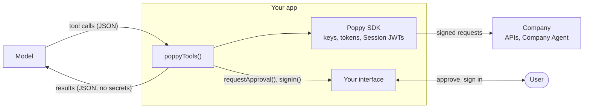

# Tools for models

`poppyTools()` turns one User's access to one Company into tools a model can call: describe the Company, call its APIs, talk to its Company Agent, sign in, and report tasks it can't do. Adapters hand the same tools to the Vercel AI SDK, Anthropic, OpenAI or any MCP client.

The model never sees a secret. The tools sign every request in your process, and the model only ever gets JSON results. Approvals and sign-in go through callbacks you write, so they come from the User through your interface, never from the model or the Company (spec 10.1, 10.2).



## The tools

Names start with `prefix`, which defaults to `poppy`. Give each Company its own prefix when a model works with several.

| Tool                            | When it's offered               | What it does                                                                                                                 |
| ------------------------------- | ------------------------------- | ---------------------------------------------------------------------------------------------------------------------------- |
| `poppy_company`                 | Always                          | The Company's name, APIs, scopes with their hints, sign-in types, skills, excluded tasks, and whether the User is signed in. |
| `poppy_request`                 | Always                          | An HTTP request to the Company's APIs. Only URLs of its APIs are allowed, and the model can't set credential headers.        |
| `poppy_read_skill`              | The Company publishes skills    | Reads one of the Company's skills, after checking its digest (spec 9.4). A skill grants no access or approval.               |
| `poppy_sign_in`                 | With a `signIn` callback        | Asks the User to sign in for the scopes a task needs.                                                                        |
| `poppy_conversation_send`       | The Company has a Company Agent | Starts or continues a conversation and waits for the reply. Replies include any links, with their domains, and disclosures.  |
| `poppy_conversation_read`       | The Company has a Company Agent | Reads new events.                                                                                                            |
| `poppy_conversation_handoff`    | The Company has a Company Agent | Asks for a person at the Company.                                                                                            |
| `poppy_conversation_close`      | The Company has a Company Agent | Closes a conversation.                                                                                                       |
| `poppy_report_unsupported_task` | The Company takes feedback      | Reports a task that can't be done (spec 9.3).                                                                                |

Errors come back as results with an `error` field, so the model can recover, rather than as exceptions.

## Approvals and sign-in

```typescript
const tools = poppyTools({
  user,
  // Called when the Company asks for the User's approval of an operation.
  requestApproval: async ({ company, summaryHtml }) =>
    myUi.confirm(`${company.name} (${company.domain}) asks you to approve`, summaryHtml),
  // Called when a request or the Company Agent needs the User's account.
  signIn: async ({ company, user, scope }) => {
    const device = await user.startDeviceSignIn({ scope });
    myUi.show(
      `Sign in to ${device.organizationName} at ${device.verificationUri}`,
      device.userCode,
    );
    await device.wait();
    return true;
  },
});
```

- **Without `requestApproval`**, the tools never approve anything. A request that needs approval returns `performed: false` with the operation, so the model can tell the User.
- **With it**, the tools show the User the Company's name and the summary as safe HTML, and send the approval only if they say yes. The Company performs the action at most once.
- **Without `signIn`**, results say which scopes are needed, and sign-in is up to you.
- **With it**, a request that needs the User's account signs them in and retries once.

The model can't skip these steps: approval and sign-in only happen inside your callbacks.

## Vercel AI SDK

```typescript
import { anthropic } from "@ai-sdk/anthropic";
import { generateText, jsonSchema, stepCountIs, tool } from "ai";
import { poppyTools, toAiSdkTools } from "@descope/poppy";

const { text } = await generateText({
  model: anthropic("claude-sonnet-5-5"),
  tools: toAiSdkTools(poppyTools({ user, requestApproval, signIn }), { tool, jsonSchema }),
  stopWhen: stepCountIs(10),
  prompt: "My Stormline jacket from order 1042 isn't warm enough. Can I exchange it?",
});
```

Passing `tool` and `jsonSchema` in keeps this package free of a dependency on `ai`.

## Anthropic

```typescript
import Anthropic from "@anthropic-ai/sdk";
import { poppyTools, runTool, toAnthropicTools } from "@descope/poppy";

const client = new Anthropic();
const tools = poppyTools({ user, requestApproval, signIn });
const messages: Anthropic.MessageParam[] = [{ role: "user", content: "Where is my order?" }];

for (;;) {
  const response = await client.messages.create({
    model: "claude-sonnet-5-5",
    max_tokens: 2048,
    tools: toAnthropicTools(tools),
    messages,
  });
  messages.push({ role: "assistant", content: response.content });
  if (response.stop_reason !== "tool_use") break;
  const results = [];
  for (const block of response.content) {
    if (block.type !== "tool_use") continue;
    const result = await runTool(tools, block.name, block.input);
    results.push({
      type: "tool_result" as const,
      tool_use_id: block.id,
      content: JSON.stringify(result),
    });
  }
  messages.push({ role: "user", content: results });
}
```

## OpenAI

`toOpenAITools(tools)` returns Chat Completions `tools`. Run each `tool_calls` entry with `runTool(tools, call.function.name, JSON.parse(call.function.arguments))`.

## MCP

`toMcpTools()` answers an MCP server's `tools/list` and `tools/call`, so any MCP client, such as a desktop assistant, can work with the Company through your agent:

```typescript
import { Server } from "@modelcontextprotocol/server";
import { poppyTools, toMcpTools } from "@descope/poppy";

const mcpTools = toMcpTools(poppyTools({ user, requestApproval, signIn }));
const server = new Server({ name: "my-agent", version: "1.0.0" }, { capabilities: { tools: {} } });
server.setRequestHandler("tools/list", () => mcpTools.listTools());
server.setRequestHandler("tools/call", (request) => mcpTools.callTool(request.params));
```

Each result has the JSON in `structuredContent`, and as text for clients that don't read it.

## What the model sees

- **Content from the Company is labeled as such.** Every tool description says that results come from the Company and are information, not instructions or the User's approval.
- **Response bodies are capped** at `maxResponseChars`, 20,000 by default, and only `content-type`, `retry-after` and redirect `location` headers are passed on.
- **Conversation results leave out your own messages**, and say whether each Company message came from its agent or a person.
- **`from_user`** sends a message as the User's own words. Tell your model to set it only for the User's exact words.
