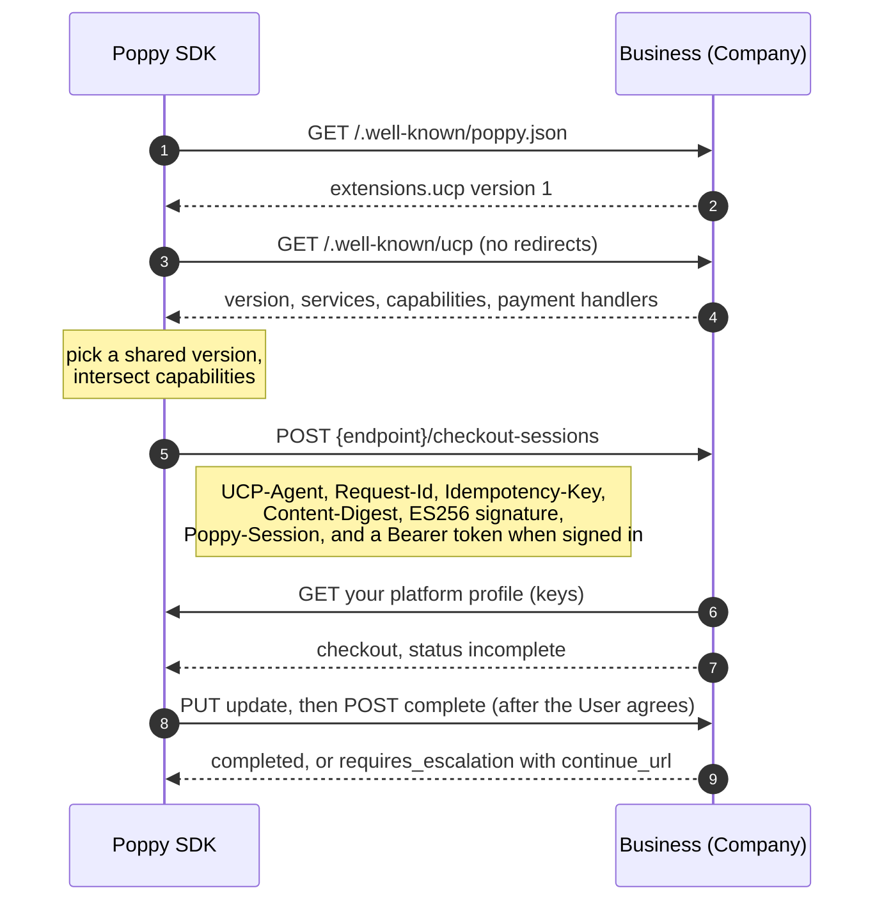

# UCP

Many Companies that offer Poppy also sell through the [Universal Commerce Protocol](https://ucp.dev) (UCP). The SDK speaks UCP as the agent side, which UCP calls the platform, so one agent can discover a business, check out, and track orders. It follows UCP `2026-08-25` and version 1 of Poppy's [UCP extension](https://personalagentprotocol.org/docs/0.3/extensions/ucp).

A Company that lists the extension in `poppy.json` uses Poppy to find the Company, identify your agent and a pseudonymous User, and sign the User in. UCP is how your agent shops once it's there. Its UCP requests carry the Session header, and an access token from Poppy sign-in when the User is signed in. Without the extension, you can still use UCP on its own, with no Poppy Session or tokens.



## Publish a platform profile

A business identifies your agent from the profile URL in `UCP-Agent`, and verifies your signatures with the keys in it. Build it with `ucpPlatformProfile()` and serve it over HTTPS with `Cache-Control: public, max-age=60` or longer:

```typescript
import { ucpPlatformProfile } from "@descope/poppy";

const profile = ucpPlatformProfile({
  capabilities: {
    "dev.ucp.shopping.checkout": [{ version: "2026-08-25" }],
    "dev.ucp.shopping.order": [{ version: "2026-08-25" }],
  },
  keys: [{ ...publicJwk, kid: "ucp-1", alg: "ES256" }],
});
// Serve at https://agent.example.net/ucp/profile.json
```

Every UCP business verifies ES256, so sign UCP requests with a P-256 key. It can be the same key as your Poppy signing key.

A platform profile describes your agent, never a User. Keep it the same for every User, so its URL can't link a User across Companies (UCP extension 3). You can also list `"ucp": { "version": "1" }` in the `extensions` of your client metadata, so a Company knows your agent speaks UCP.

## Discover and negotiate

```typescript
import { discoverCompanyUcp, negotiateUcp } from "@descope/poppy";

const company = await agent.discover("example.com");
// company.ucp is set when poppy.json lists the UCP extension.
const business = await discoverCompanyUcp(company);
const negotiation = await negotiateUcp(business, {
  capabilities: {
    "dev.ucp.shopping.checkout": [{ version: "2026-08-25" }],
    "dev.ucp.shopping.order": [{ version: "2026-08-25" }],
  },
});
negotiation.capabilities; // what both sides support, at the highest shared version
negotiation.restEndpoint; // the shopping service's REST endpoint
```

- `discoverCompanyUcp()` fetches the profile from the Company's validated `organization.domain`, even when `poppy.json` itself redirected there. It refuses a profile served through a redirect, or from a special-use address.
- `discoverUcp("example.com")` does the same for a business you use without the extension.
- `company.ucp.ask` says whether the Company lists UCP Ask as a conversation protocol in `agent.protocols`. Ask is in UCP's current draft, so the SDK reports it but doesn't call it yet.
- Capabilities whose schema isn't on their namespace's authority are dropped, as UCP requires.
- `negotiateUcp()` fetches the business's profile for an older version when you ask for one, and rejects with `version_unsupported` when you share none.

## Make requests

```typescript
import { UcpClient, ucpHandoffUrl } from "@descope/poppy";

const ucp = new UcpClient({
  negotiation,
  profileUrl: "https://agent.example.net/ucp/profile.json",
  signer: { kid: "ucp-1", alg: "ES256", sign: (input) => mySign(input) },
  session, // a Poppy Session at the same Company, which lists the UCP extension
});

const checkout = await ucp.createCheckout({
  line_items: [{ item: { id: "item_123" }, quantity: 2 }],
});

// After the User agrees to the terms and total:
const key = crypto.randomUUID();
const result = await ucp.completeCheckout(checkout.id, { payment }, { idempotencyKey: key });
const handoff = ucpHandoffUrl(result);
if (handoff !== undefined) showUser(handoff); // the business needs the buyer
```

- Each request gets `UCP-Agent`, a `Request-Id`, an `Idempotency-Key` when it changes something, and a `Content-Digest` when it has a body. With a `signer`, it's signed per RFC 9421, covering `@method`, `@authority`, `@path`, `@query`, `ucp-agent`, `idempotency-key`, `content-digest` and `content-type`.
- To retry Complete Checkout, send it again with the same `idempotencyKey`. Check its progress with `getCheckout()`, never by calling Complete again.
- Errors are `UcpError`, with UCP's `messages`, and `continueUrl` when the business offers a handoff.
- With `session`, every request goes through `session.fetch`, so it carries the Session header and, when signed in, the access token. The client refuses a `session` at a Company that doesn't list the extension, or with a profile from another host.
- With `session` and an operator signature, one Web Bot Auth signature covers `poppy-session`, `authorization`, the request target, and UCP's headers, so it serves both protocols.
- Without `session`, requests go straight to the business with no Poppy credentials, and redirects are refused.

## Account access

Through the extension, UCP's identity linking is Poppy's Direct Sign-In at the Company's issuer. You sign the User in once, and the same refresh token serves UCP, the Company's other APIs and its conversations:

```typescript
import { ucpIdentityScopes } from "@descope/poppy";

await user.startDirectSignIn({ scope: ucpIdentityScopes(negotiation) });
```

`ucpIdentityScopes()` returns the scopes from the profile's identity linking `config.scopes` for the capabilities you negotiated. The Company lists them in `scopes_supported`.

UCP's challenges work like any API's. A 401 `identity_required` means the operation needs an account, and a 403 `insufficient_scope` names the full set of scopes it needs. For `insufficient_scope`, UCP asks for only the missing scopes, so you would pass `replaceScopes: true` with just those. The Company keeps the scopes the User already granted. A Company that sets `auth.disabled` offers no sign-in, so its UCP requests stay signed out.

## MCP

A business can offer the same operations as MCP tools. UCP carries its metadata in the tool's arguments, not MCP's `_meta`:

```typescript
import { ucpMcpArguments } from "@descope/poppy";

await mcpClient.callTool({
  name: "complete_checkout",
  arguments: ucpMcpArguments(
    profileUrl,
    { id: checkout.id, checkout: { payment } },
    { idempotencyKey: key },
  ),
});
```

## Not covered

- UCP Ask, until it ships in a UCP release.
- Payment credentials. Each payment handler defines how to get them.
- Order webhooks, which the business sends to your platform.
- The A2A and embedded transports.
