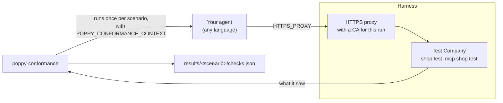

# Personal Agent Protocol Conformance

Conformance tests for Personal Agents that implement the [Personal Agent Protocol](https://personalagentprotocol.org/docs/spec.md), in any language. The spec project's validator tests Companies; this tests the other side.

<details>
<summary>Table of Contents</summary>

- [Quick Start](#quick-start)
- [Overview](#overview)
- [Usage](#usage)
- [The agent contract](#the-agent-contract)
- [Test Results](#test-results)
- [Expected Failures](#expected-failures)
- [GitHub Action](#github-action)
- [Scenarios and checks](#scenarios-and-checks)
- [Integrating with your SDK](#integrating-with-your-sdk)

</details>

## Quick Start

```bash
# Run every scenario against your agent
npx @descope/poppy-conformance agent --command "python my_agent.py"

# Run one suite, or one scenario
npx @descope/poppy-conformance agent --command "python my_agent.py" --suite oauth
npx @descope/poppy-conformance agent --command "python my_agent.py" --scenario sign-in

# List scenarios and checks
npx @descope/poppy-conformance list
```

The package isn't published to npm yet. Until it is, run `node packages/conformance/src/cli.ts` from this repository after `pnpm install && pnpm run build`.

## Overview

For each scenario, the harness:

1. Sets up a test Company that behaves as the scenario says, such as one whose `poppy.json` names another domain, or whose issuer rotates refresh tokens.
2. Runs your agent once, with the scenario in its environment.
3. Records every request your agent sends, and checks it against the rules spec 0.4 and 0.3 set for Personal Agents.
4. Writes the results, and reports each check as passed, failed or skipped.

The protocol requires HTTPS and real hostnames, so the harness is an HTTPS proxy rather than a local server. Your agent reaches the test Company's hosts (`shop.test`, `www.shop.test`, `mcp.shop.test`) through `HTTPS_PROXY`, and trusts a certificate authority made for the run. Most HTTP clients honor both through standard environment variables, so your agent needs no test-only code paths.



## Usage

```bash
npx @descope/poppy-conformance agent --command "<command>" [options]
```

| Option                       | Description                                                                                   |
| ---------------------------- | --------------------------------------------------------------------------------------------- |
| `--command`                  | The command that runs your agent. The website URL is appended to it.                          |
| `--scenario <name>`          | Run one scenario. Repeat it for several.                                                      |
| `--suite <suite>`            | `all` (default), `core`, `oauth` or `interactions`.                                           |
| `--expected-failures <file>` | A YAML baseline of known failures. See [Expected Failures](#expected-failures).               |
| `--client-id <url>`          | Your agent's published `client_id`. Without it, the harness gives your agent a test identity. |
| `--redirect-uri <url>`       | Your agent's redirect URI, with `--client-id`.                                                |
| `--timeout <ms>`             | Per scenario. Defaults to 30000.                                                              |
| `--results <dir>`            | Where to write results. Defaults to `./results`.                                              |
| `--verbose`                  | Print each scenario's output.                                                                 |

Without `--expected-failures`, the run exits 1 if any MUST check fails. SHOULD checks are reported, and don't fail the run.

## The agent contract

Your agent is a program the harness runs once per scenario. It gets:

| Variable                                                                       | Contents                                                                                                                                                             |
| ------------------------------------------------------------------------------ | -------------------------------------------------------------------------------------------------------------------------------------------------------------------- |
| `POPPY_CONFORMANCE_SCENARIO`                                                   | The scenario's name.                                                                                                                                                 |
| `POPPY_CONFORMANCE_CONTEXT`                                                    | JSON with `steps`, `client_id`, `redirect_uri`, `user_id`, `website` and, with the test identity, `signing_key`: the private JWK to sign with, with `kid` and `alg`. |
| `HTTPS_PROXY`, `HTTP_PROXY`                                                    | The harness. `NODE_USE_ENV_PROXY=1` turns it on for Node's `fetch`.                                                                                                  |
| `NODE_EXTRA_CA_CERTS`, `SSL_CERT_FILE`, `REQUESTS_CA_BUNDLE`, `CURL_CA_BUNDLE` | The run's CA certificate.                                                                                                                                            |

Your agent carries out the `steps` in order, with its normal code:

| Step                                                           | What your agent does                                                                                                                                 |
| -------------------------------------------------------------- | ---------------------------------------------------------------------------------------------------------------------------------------------------- |
| `{"action": "discover", "website"}`                            | Discover the Company, and get ready to act for `user_id` there.                                                                                      |
| `{"action": "request", "url", "method"?, "body"?}`             | Send the request through its Session, signed in if it is.                                                                                            |
| `{"action": "sign_in", "scopes"}`                              | Direct Sign-In. Act as the User's browser: GET the authorization URL without following redirects, and finish sign-in with the `Location` it returns. |
| `{"action": "sign_out"}`                                       | Sign out.                                                                                                                                            |
| `{"action": "converse", "text"}`                               | Start a conversation with the Company Agent, then send one more message.                                                                             |
| `{"action": "request_with_approval", "url", "method", "body"}` | Send the request. When the Company answers `approval_required`, approve the operation as if the User said yes, and send it again with the approval.  |

When a step fails, print one JSON line, `{"step": "<action>", "error": "<message>"}`, and go on to the next. Some scenarios expect steps to fail: an agent that refuses a bad Company can't send it requests afterward. The harness judges what your agent sends, not its exit code.

## Test Results

Each scenario writes `results/<scenario>-<timestamp>/`:

- `checks.json`: the scenario's checks, each with `status` and `details`
- `stdout.txt` and `stderr.txt`: your agent's output

The CLI then prints a line per check, across every scenario:

```text
Personal Agent Protocol 0.4 and 0.3 conformance: 48 passed, 0 failed, 2 skipped
SKIP  MUST   4.1           identity.metadata
PASS  MUST   3             discovery.well-known-path
...
```

With the test identity, the two identity checks test the harness rather than your agent, so they're skipped. Pass `--client-id` with your published identity to run them.

## Expected Failures

An agent that doesn't pass everything yet can list its known failures, so conformance runs in CI and still catches regressions. An entry is a whole scenario, or one check in it as `<scenario>:<check-id>`:

```yaml
# conformance-baseline.yml
agent:
  - sign-in-dpop # the whole scenario may fail
  - sign-in:oauth.dpop # only this check may fail
```

```bash
npx @descope/poppy-conformance agent --command "python my_agent.py" --expected-failures ./conformance-baseline.yml
```

| Check result | In the baseline? | Outcome                         |
| ------------ | ---------------- | ------------------------------- |
| Fails        | Yes              | Exit 0, an expected failure     |
| Fails        | No               | Exit 1, a regression            |
| Passes       | Yes              | Exit 1, a stale entry to remove |
| Passes       | No               | Exit 0                          |

Write `scenario:check` with no space after the colon, since YAML reads `scenario: check` as a mapping.

## GitHub Action

```yaml
- uses: actions/setup-node@v4
  with:
    node-version: 24
- uses: descope/poppy-js/packages/conformance@main
  with:
    command: python my_agent.py
    expected-failures: ./conformance-baseline.yml
```

| Input               | Description                                         |
| ------------------- | --------------------------------------------------- |
| `command`           | Required. The command that runs your agent.         |
| `suite`             | `all` (default), `core`, `oauth` or `interactions`. |
| `expected-failures` | A YAML baseline of known failures.                  |
| `client-id`         | Your agent's published `client_id`.                 |
| `version`           | The package version to run. Defaults to `latest`.   |

## Scenarios and checks

`poppy-conformance list` prints every scenario and check. The 32 checks are each tied to a spec section and level:

| Area                 | What's checked                                                                                                                                                                                                                                                                                      |
| -------------------- | --------------------------------------------------------------------------------------------------------------------------------------------------------------------------------------------------------------------------------------------------------------------------------------------------- |
| Agent identity (4.1) | Client metadata and a public-only key set                                                                                                                                                                                                                                                           |
| Discovery (3)        | Refusing uploaded or misdirected documents, wrong domains, unsupported versions, unlinked issuers, failed metadata and private addresses                                                                                                                                                            |
| Sessions (5)         | The Session header everywhere it belongs and nowhere else, even on a listed host, the Session JWT's form and claims, `ath`, delegations and their privacy, one delegated key per User ID, stable IDs, no secrets in URLs, a new Session after `session_ended`, and no retry after `invalid_session` |
| OAuth (4)            | Client assertions, Direct Sign-In with PKCE, the `iss` check, extra scopes, refresh rotation, revocation, DPoP, and resource tokens for MCP                                                                                                                                                         |
| Requests (3)         | No credentials to a redirect's target, and no plain HTTP                                                                                                                                                                                                                                            |
| Conversations (8)    | Message IDs, authors and content                                                                                                                                                                                                                                                                    |
| Operations           | The approval header, on the same request                                                                                                                                                                                                                                                            |

Not covered yet: Device and Mediated Sign-In, browser join, streaming, task coverage, and rules about what an agent shows the User.

## Integrating with your SDK

1. **Write an everything-agent.** A small program that reads `POPPY_CONFORMANCE_CONTEXT` and carries out each step with your SDK's public API. This SDK's is [`examples/conformance-agent.ts`](../../examples/conformance-agent.ts), about a hundred lines. A test identity is in the context, so your agent doesn't need a published one.
2. **Make sure your HTTP client uses the proxy and CA.** Python's `requests` and `httpx`, Go's `net/http`, and curl read the variables above by default. Node's `fetch` needs Node 22.21 or 24.5 and later, and reads them with `NODE_USE_ENV_PROXY=1`, which the harness sets.
3. **Run it, and baseline what fails.** Commit the baseline, and run the suite in CI with the GitHub Action. Remove entries as you fix them. The run fails when you forget.

A Python agent's main loop looks like this:

```python
import json, os

context = json.loads(os.environ["POPPY_CONFORMANCE_CONTEXT"])
agent = MyAgent(client_id=context["client_id"], signing_key=context["signing_key"])

for step in context["steps"]:
    try:
        agent.run(step)  # dispatch on step["action"] to your SDK
    except Exception as error:
        print(json.dumps({"step": step["action"], "error": str(error)}))
```

### In-process for TypeScript

TypeScript agents can also run the same scenarios in one process, with no proxy, through `runConformance()` from `@descope/poppy/conformance`. See [docs/conformance.md](../../docs/conformance.md).
